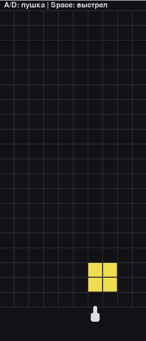
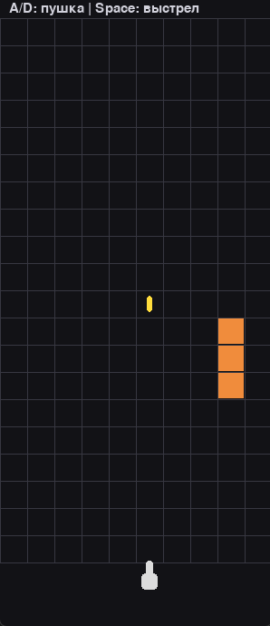

# BlockDefenseGame
## Тетрис-защита

Сверху падают блоки разной формы. Игрок в Pygame управляет пушкой снизу, которая стреляет по блокам. Попадание разрушает блок на отдельные кубики. Цель - не дать блокам составить сплошную линию на полу.

---
## Стек технологий
- **Python 3.14**
- **Pygame-ce 2.5.8** - графический движок, обработка ввода и отрисовка
---
## Структура проекта
```
BlockDefenseGame/py_block_defense/
├── main.py   # Точка входа в приложение: игровой цикл, обработка ввода, счёт/выстрелы, проигрыш.
├── _init_.py # Документация пакета
├── config.py # Константы и настройки (размеры, тайминги, цвета, очки).
├── mechanics.py # Игровая логика: матрица стакана, спавн/падение/фиксация фигур, очистка рядов, попадания.
├── render.py # Отрисовка стакана, фигур, пушки и снаряда.
├── shapes_loader.py # Загрузка `shapes.json` и валидация масок фигур.
├── logger.py # Запись результатов сессии при проигрыше в `defense.log`.
├── shapes.json # Набор фигур в виде матриц-масок (1/0) и их цвета.
├── defense.log # Файл логов: счёт, длительность сессии и количество выстрелов (создаётся автоматически).
```
### Назначение модулей

| Модуль | Назначение |
|--------|-----------|
| `main.py` | Запуск игры: игровой цикл, ввод, счёт, завершение/логирование |
| `config.py` | Константы и настройки проекта |
| `mechanics.py` | Игровая логика: сетка, фигуры, столкновения, очистка рядов |
| `render.py` | Отрисовка элементов игры в Pygame |
| `shapes_loader.py` | Загрузка и проверка фигур из shapes.json |
| `logger.py` | Запись результатов сессии в defense.log |

---

## Запуск игры
Запуск из папки `BlockDefenseGame/py_block_defense/`:
```bash
cd BlockDefenseGame/py_block_defense/
python3 main.py
```
---
## Управление
| Клавиша | Действие |
|---------|----------|
| `A` `D` | Перемещение пушки |
| `Space` | Выстрел |
| `Закрыть окно` | Выход из игры |
---
## Интерфейс
Отображается стакан 10x20 с падающей фигурой и пушкой снизу.

## Конфигурация

Основные параметры игры хранятся в `config.py`:

```python
GRID_W, GRID_H = 10, 20          # Размер стакана в клетках: ширина (столбцы) и высота (строки)
CELL = 30                        # Размер одной клетки сетки в пикселях
TOP_MARGIN = 20                  # Отступ сверху (место под HUD/текст)
BOTTOM_UI = 70                   # Нижняя область под интерфейс (пушка/подписи)

WIDTH = GRID_W * CELL            # Ширина окна в пикселях (ширина стакана * размер клетки)
HEIGHT = TOP_MARGIN + GRID_H * CELL + BOTTOM_UI  # Высота окна: верхний отступ + стакан + нижняя UI-зона

DROP_INTERVAL_MS = 1000          # Интервал падения фигуры (мс): 1 клетка вниз раз в секунду
BULLET_STEP_MS = 25              # Интервал шага пули (мс): скорость движения снаряда вверх

BG = (18, 18, 22)                # Цвет фона окна (RGB)
GRID_LINE = (55, 55, 65)         # Цвет линий сетки стакана (RGB)
CANNON_COLOR = (220, 220, 220)   # Цвет пушки (RGB)
BULLET_COLOR = (255, 220, 60)    # Цвет снаряда (RGB)

SCORE_HIT = 1                    # Количество очков за попадание (удаление сегмента фигуры)
SCORE_ROW = 10                   # Количество очков за очистку одного полностью заполненного ряда
```

## Файлы данных

### shapes.json

Внешний конфигурационный файл с шаблонами падающих фигур. Содержит список фигур в виде масок-матриц 0/1 и их цветов. Загружается при старте игры и используется для генерации случайных падающих объектов.

```json
[
  { "name": "I", "color": [80, 200, 240], "mask": [[1, 1, 1, 1]] },
  { "name": "O", "color": [240, 220, 80], "mask": [[1, 1], [1, 1]] },
  { "name": "T", "color": [180, 80, 220], "mask": [[0, 1, 0], [1, 1, 1]] },
  { "name": "L", "color": [240, 140, 60], "mask": [[1, 0], [1, 0], [1, 1]] },
  { "name": "J", "color": [80, 120, 240], "mask": [[0, 1], [0, 1], [1, 1]] },
  { "name": "S", "color": [80, 220, 120], "mask": [[0, 1, 1], [1, 1, 0]] },
  { "name": "Z", "color": [240, 80, 80], "mask": [[1, 1, 0], [0, 1, 1]] }
]
```

### defense.log

Лог-файл с временными метками, создаётся автоматически. Запись производится при проигрыше (когда новую фигуру невозможно заспавнить из-за заполнения верхней части стакана). В лог добавляется одна строка с итоговыми параметрами сессии:
- score - итоговый счет,
- duration - длительность сессии (в секундах),
- shots - количество сделанных выстрелов.

Пример:
```
[2026-10-19 16:47:28] score=37 duration=42.3s shots=12
[2026-10-19 17:05:11] score=14 duration=19.8s shots=5
```

## Скриншоты



_Основной экран: сетка стакана 10x20, падающий блок и пушка._



_Удаление сегмента падающего блока._
## Зависимости
Убедитесь, что установлен Python 3.14+ и Pygame-ce 2.5.8:
```bash
pip list
```
Если Pygame не установлен:
```bash
pip install pygame-ce
```
