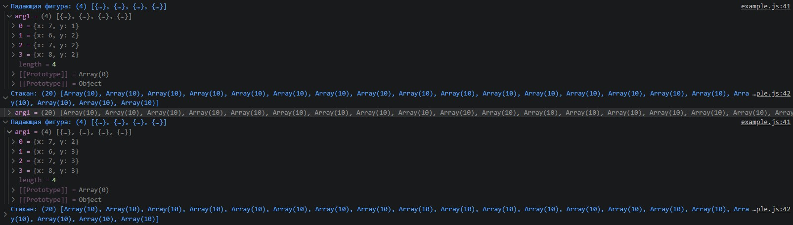

# js_block_defense - игровое ядро "Тетрис-защиты" на JavaScript.

Перенос игровой логики "Тетрис-защиты" с Python/Pygame на **JavaScript (ES6+)**:
матрица стакана, падение фигур, проверка коллизий и очистка заполненных рядов.
Реализация работает в Node.js без графического интерфейса.

**Что внутри:**

1. **Объектно-ориентированная структура** - классы `GameField`, `FallingShape` и `Cannon`
2. **Игровая логика** - матрица стакана 10x20, падение и фиксация фигур, очистка заполненных рядов со сдвигом верхних вниз.
3. **Проверка коллизий** - фигура не проходит сквозь дно стакана или зафиксированные кубики
4. **Пушка** - перемещение по столбцам и удаление нижнего сегмента падающей фигуры в выбранном столбце.

## Структура

```
js_block_defense/          # игровое ядро без интерфейса
├── package.json           # type: module — запуск ES-модулей в Node.js
├── README.md
├── GameField.js           # стакан, коллизии и очистка рядов
├── FallingShape.js        # падающая фигура и её кубики
├── Cannon.js              # пушка и удаление сегментов фигуры
└── example.js             # демонстрация игрового цикла в консоли
```

## Запуск

Требуется Node.js. Проект запускался с версией Node.js 26.13.1, установка дополнительных зависимостей не требуется.

```bash
cd js_block_defense

# Запуск демонстрации игрового цикла в консоли
node example.js
```



> **Про интерфейс.** В этой версии реализовано только игровое ядро - без отрисовки и управления.
> Демонстрация работает в консоли Node.js, без браузера.

## Ключевые отличия от Python-версии "Тетрис-защиты"

| Аспект | Python/Pygame | JavaScript/Node.js |
|---|---|---|
| Структура | Функции, разделённые по модулям | Классы `GameField`, `FallingShape`, `Cannon` |
| Шаблоны фигур | Загрузка из `shapes.json` | Маски заданы в `example.js` |
| Выстрел | Снаряд летит вверх и удаляет сегмент | Метод `shoot()` сразу удаляет нижний сегмент в столбце |
| Игровой цикл | Цикл Pygame | `setInterval` в `example.js` |
| Отрисовка и управление | Окно Pygame, клавиши A/D и пробел | Не реализованы; состояние выводится в консоль |

## Возможности ядра

- [x] Классы `GameField`, `FallingShape` и `Cannon` - каждый в своём модуле
- [x] Двумерная матрица стакана и фигуры, заданные масками
- [x] Падение фигур с проверкой границ и столкновений
- [x] Фиксация фигур и очистка заполненных рядов
- [x] Перемещение пушки и удаление сегмента падающей фигуры в выбранном столбце
- [x] Демонстрация игрового цикла в консоли Node.js
