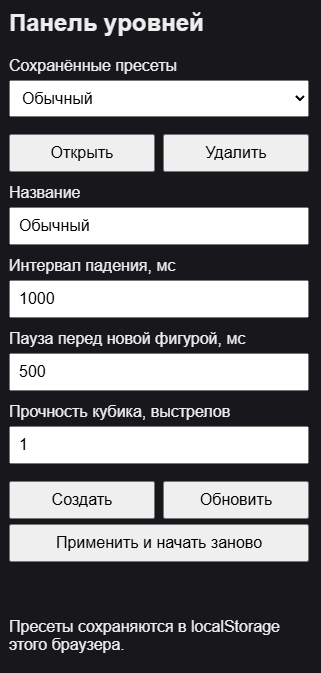

# "Тетрис-защита" - панель управления пресетами сложности (CRUD)

Веб-панель для настройки и хранения пресетов сложности игры в `localstorage`

## Структура проекта

```
js_crud_block_defense/
├── index.html    # страница с игрой и панелью уровней
├── game.js       # игровой цикл и логика CRUD-панели
├── presets.js    # хранение и проверка пресетов в localStorage
├── GameField.js  # стакан, коллизии и очистка рядов
├── FallingShape.js # падающая фигура и её кубики
├── Cannon.js     # пушка и её перемещение
└── style.css # оформление страницы
```

## Запуск
1. Запустите статический сервер из папки `js_crud_block_defense`:
   ```bash
   cd js_crud
   python -m http.server 8001
   ```
2. Откройте в браузере: `http://localhost:8001/`

## Описание полей
Каждый пресет сложности содержит:
- **name** — уникальное название пресета (обязательная строка, до 50 символов)
- **dropInterval** — интервал падения на одну клетку (100-10000 мс)
- **spawnInterval** — пауза перед появлением следующей фигуры (0-10000 мс)
- **durability** — количество попаданий для уничтожения кубика (от 1 до 20)

## CRUD-операции

### Create (создание)
Заполните форму пресета и нажмите "Создать". Поля проверяются, после чего пресет сохраняется в `localStorage` и появляется в списке

### Read (чтение)
Выберите пресет в списке и нажмите "Открыть" - его параметры появятся в форме.

### Update (обновление)
Выберите пресет, измените параметры в форме и нажмите "Обновить". Перед сохранением поля проверяются.

### Delete (удаление)
Выберите пресет и нажмите "Удалить". После подтверждения он удаляется из `localStorage`.
Чтобы применить сохранённый пресет к игре, нажмите "Применить и начать заново"

## Персистентность

- Ключ LocalStorage: `tetris_defense_presets`
- Формат: JSON-массив объектов пресетов сложности
- Данные сохраняются после создания, обновления и удаления пресета
- При перезагрузке страницы сохранённые пресеты остаются в браузере

## Пример данных в localStorage

```json
[
  {
    "name": "Лёгкий",
    "dropInterval": 1500,
    "spawnInterval": 1000,
    "durability": 1
  },
  {
    "name": "Сложный",
    "dropInterval": 500,
    "spawnInterval": 200,
    "durability": 3
  }
]
```

## Технические детали
- **Хранение**: пресеты сохраняются в `localStorage` между сеансами браузера
- **Идентификация**: пресеты различаются по уникальному названию `name`
- **Валидация**: HTML5-атрибуты формы и JavaScript-проверка перед сохранением
- **Вывод данных**: названия добавляются через `textContent`, без вставки пользовательского HTML
- **Обработка событий**: для кнопок панели назначены отдельные обработчики
- **Применение пресета**: выбранные параметры запускают игру заново


