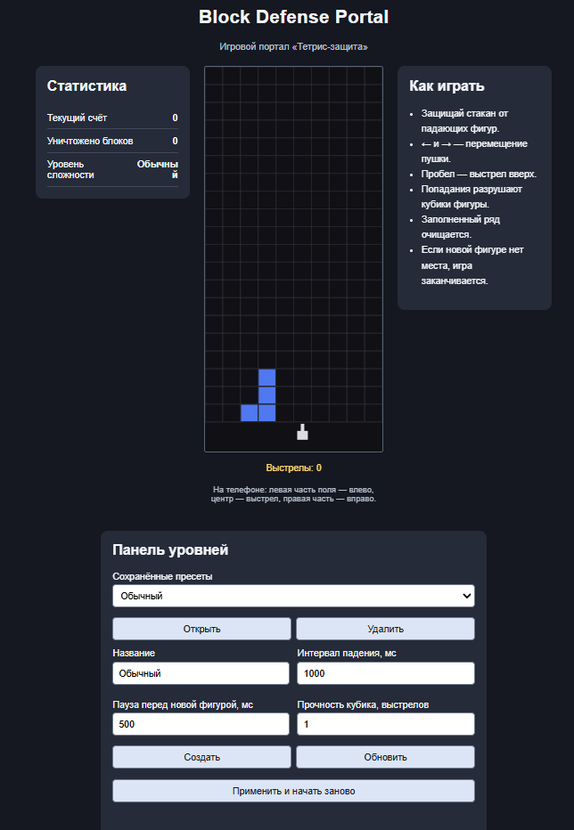
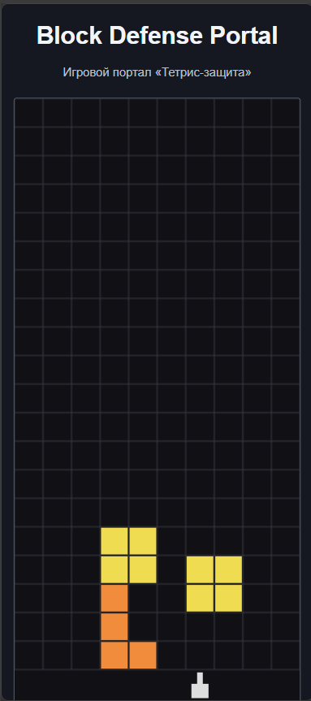
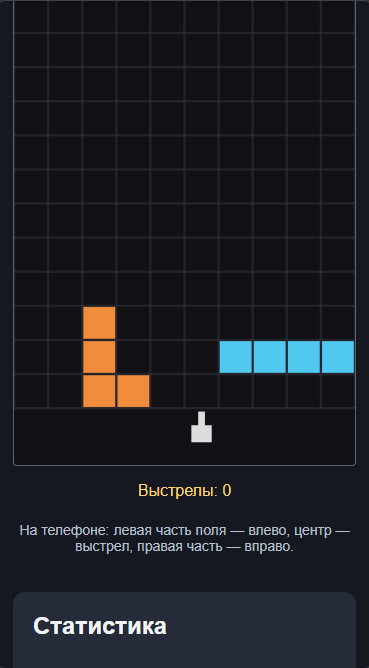
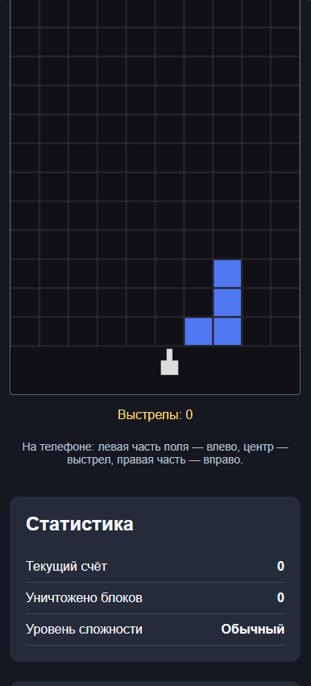
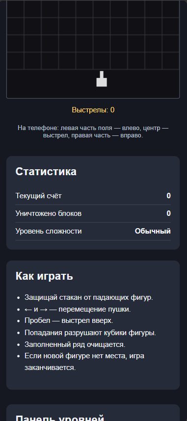
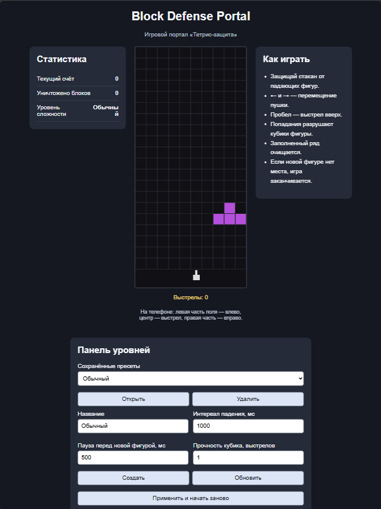

# js_site_block_defense - веб-портал игры "Тетрис-защита" (Block Defense Portal): игровой экран на Canvas по центру, панели статистики и инструкции по бокам, адаптивная вёрстка на Flexbox и сенсорное управление

Адаптивная веб-страница Block Defense Portal объединяет игровой виджет на Canvas, панель статистики, инструкцию и панель управления пресетами сложности в `localStorage`. Управление доступно с клавиатуры и с помощью касаний на мобильных устройствах.

## Структура проекта

```
js_site/
├── index.html         # страница: игра, статистика, инструкция и панель уровней
├── style.css          # оформление и адаптивная вёрстка
├── game.js            # игровой цикл, управление, отрисовка и панель пресетов
├── presets.js         # проверка и хранение пресетов в localStorage
├── GameField.js       # стакан, коллизии и очистка рядов
├── FallingShape.js    # падающая фигура и её кубики
├── Cannon.js          # пушка и её перемещение
└── README.md
```

## Запуск

Нужен локальный статический сервер для загрузки ES-модулей
```bash
cd js_site
python -m http.server 8002
# Открыть http://localhost:8002/
```

## Что реализовано

| Компонент | Описание |
|---|---|
| Вёрстка | Игровой экран по центру, статистика слева, инструкция справа; выравнивание через Flexbox |
| Игровой виджет | Canvas, падающие фигуры, пушка, пули и цикл `requestAnimationFrame` |
| Статистика | Текущий счёт, количество уничтоженных кубиков и уровень сложности |
| Управление | Стрелки влево/вправо и пробел; на мобильных устройствах — касания левой, центральной и правой частей холста |
| Адаптивность | На узком экране игра и боковые панели располагаются друг под другом |
| Панель уровней | Создание, чтение, обновление и удаление пресетов сложности в localStorage |

## Управление

**На десктопе:**
- `←` / `→` — перемещение пушки
- `Пробел` — выстрел

**На мобильном устройстве:**
- Тап по левой / правой части холста — перемещение пушки
- Тап по центру холста — выстрел

## Интеграция с другими модулями

- Игровой виджет и управление реализованы в `game.js`
- Игровая логика использует классы `GameField`, `FallingShape` и `Cannon`
- Пресеты сложности хранятся в `localStorage` под ключом `tetris_defense_presets` и обрабатываются модулем `presets.js`

## Скриншоты

### Десктоп


### Мобильная адаптация


| iPhone SE | iPhone 16 | Pixel 9 |
|---|---|---|
|  |  |  |

### Планшет


## Тестирование

После запуска через локальный сервер проверьте:

- Отображение игры, статистики и инструкции.
- Управление пушкой стрелками и выстрел пробелом.
- Обновление счёта и количества уничтоженных кубиков.
- Управление касаниями на мобильном экране.
- Создание, изменение, удаление и применение пресетов.
