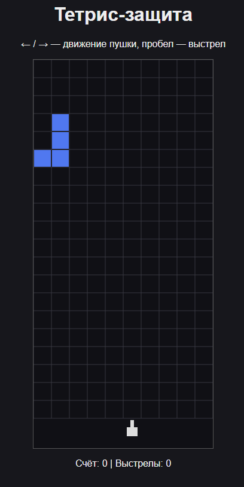

# js_widget_block_defense - веб-виджет игры "Тетрис-защита" на HTML5 Canvas.

Интерактивный веб-виджет «Тетрис-защита»: отрисовка на HTML5 Canvas, игровой цикл через `requestAnimationFrame`,
управление пушкой стрелками и стрельба пробелом. При попадании пуля удаляет кубик падающей фигуры. Виджет использует классы игрового ядра из
[`../js_block_defense`](../js_block_defense)

## Структура

```
js_widget/
├── index.html          # страница с игровым холстом
├── style.css           # оформление страницы и виджета
├── game.js             # игровой цикл, управление и отрисовка
├── GameField.js        # стакан, коллизии и очистка рядов
├── FallingShape.js     # падающая фигура и её кубики
├── Cannon.js           # пушка и её перемещение
├── screenshots/
│   └── widget.png      # скриншот работающего виджета
└── README.md
```

## Запуск

Для запуска нужен локальный статический сервер, поскольку используются ES-модули. 
Например, можно воспользоваться расширением Live Server в VS Code.

```bash
cd js_widget
python -m http.server 8000
# Открыть http://localhost:8000/
```

На некоторых системах вместо `python` используется `python3`
Дополнительные зависимости не нужны: для работы виджета достаточно браузера и локального статического сервера. 
Node.js для запуска виджета не требуется.

## Управление

| Клавиша | Действие |
|---|---|
| ← / → | Перемещение пушки влево / вправо |
| Пробел | Выстрел вверх |

## Что реализовано
- [x] Отрисовка игрового поля на HTML5 Canvas
- [x] Игровой цикл с помощью `requestAnimationFrame`
- [x] Падение фигур и очистка заполненных рядов
- [x] Управление пушкой стрелками влево и вправо
- [x] Выстрел пробелом: пуля летит вверх и удаляет кубик при попадании
- [x] Отображение счёта и количества выстрелов
- [x] Использование классов игрового ядра: `GameField`, `FallingShape`, `Cannon`


